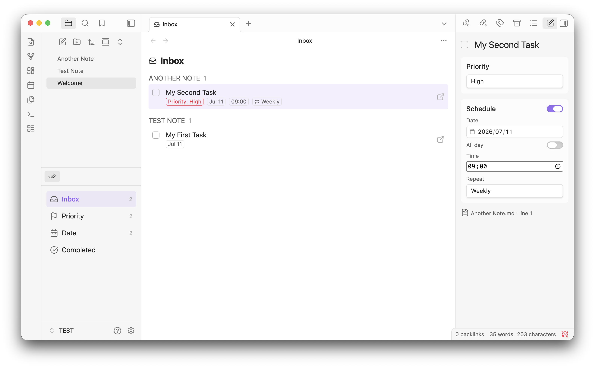

# UltiTasks

A lightweight full-GUI task manager for [Obsidian](https://obsidian.md) that works directly on 
markdown checkboxes in your notes.



## Features

- **Inline Tasks** — Every task is written as a markdown checkbox with `@key(value)` tokens.
  Priority, due date and time, and repeat can be set.
- **List View** provides four views navigated by sidebar:
  - **Inbox** — every task grouped by the note it lives in.
  - **Priority** — tasks grouped High → Medium → Low → No priority.
  - **Date** — tasks grouped into Overdue / Today / the next 7 days.
  - **Completed** — done tasks grouped by completion date.
- **Edit panel** — Set priority, schedule a date/time, toggle all-day, or set a repeat rule for the selected task.
- **Recurring tasks.** When you check off a task with a repeat rule,
  the line is checked and the next occurrence is inserted under it, with the date advanced.
- **Live sync.** The sidebar and edit panel update automatically as you edit notes in the main
  editor

## Task syntax

```markdown
- [ ] Write the quarterly report @priority(high) @date(2026-08-01) @time(09:00) @repeat(weekly)
- [x] Renew domain @done(2026-07-10)
```

| Attribute     | Values                                            | Notes                                  |
| ------------- | -------------------------------------------------- | --------------------------------------- |
| `@priority`   | `high`, `medium`, `low`                            | Omit for no priority                    |
| `@date`       | `YYYY-MM-DD`                                       | The task's scheduled date               |
| `@time`       | `HH:MM` (24-hour)                                  | Requires `@date`; omit for an all-day task |
| `@repeat`     | `never`, `daily`, `weekly`, `monthly`, `yearly`    | Requires `@date`                        |
| `@done`       | `YYYY-MM-DD`                                       | Set automatically when a task is checked |

Everything else on the line is treated as the task's name.

## Installation

This plugin isn't on the Obsidian community plugin store. To install manually:

1. Download or build `main.js`, `manifest.json`, and `styles.css` (see [Development](#development)).
2. Copy them into `<your-vault>/.obsidian/plugins/ultitasks/`.
3. Reload Obsidian and enable **UltiTasks** in Settings → Community plugins.

## Development

```bash
npm install
npm run dev     # watch build
npm run build   # type-check + production build
```

The build (via `esbuild.config.mjs`) bundles `src/main.ts` into `main.js` at the project root, which
Obsidian loads directly alongside `manifest.json` and `styles.css`.
